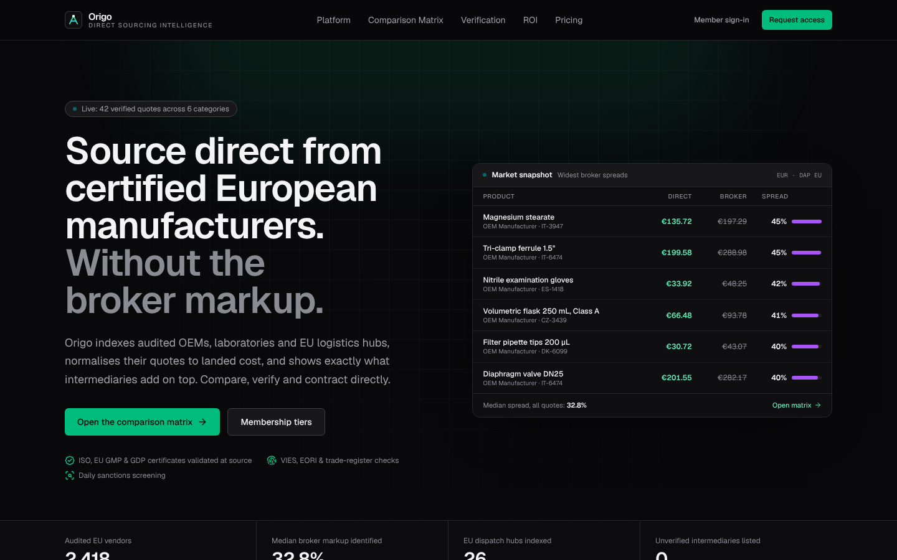
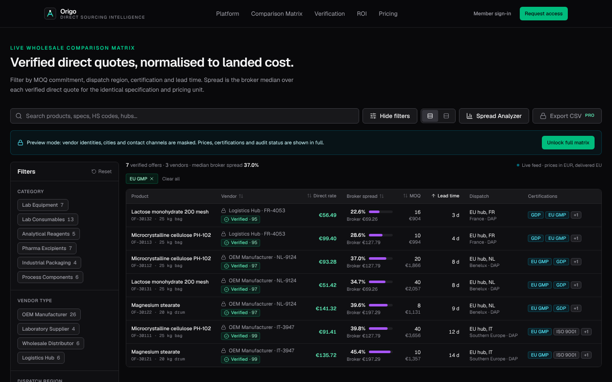
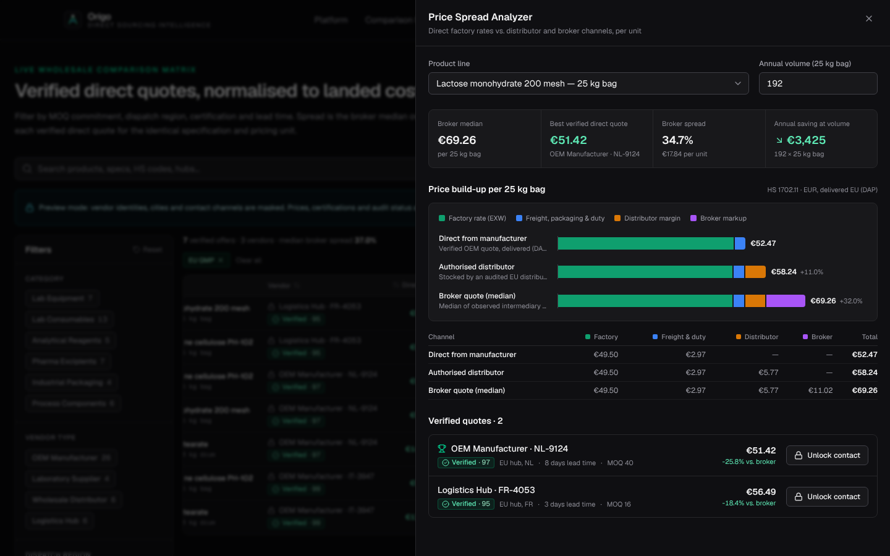
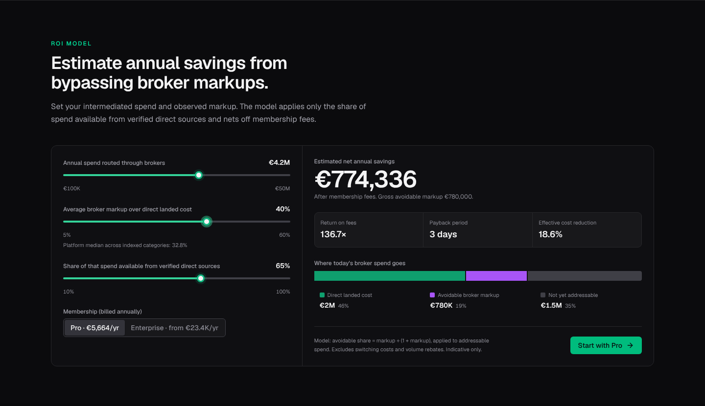
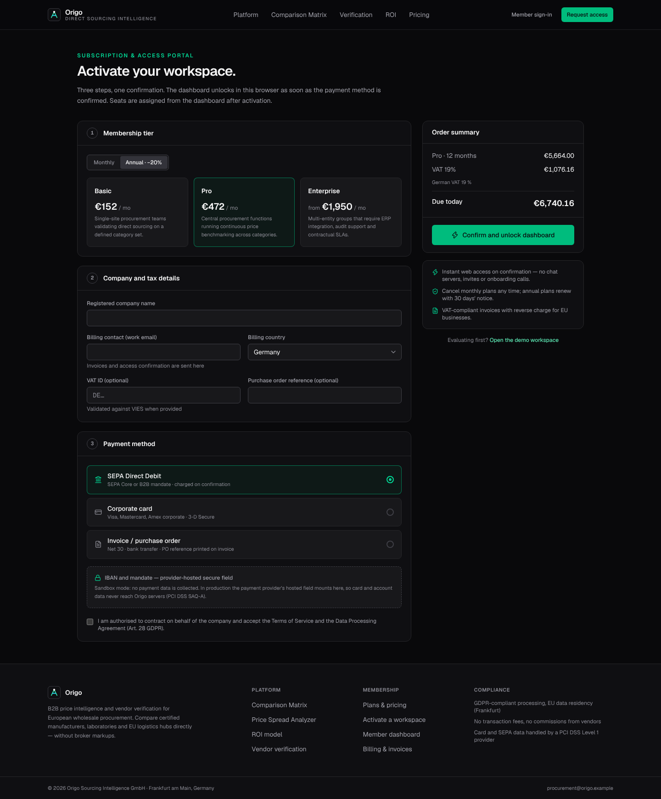
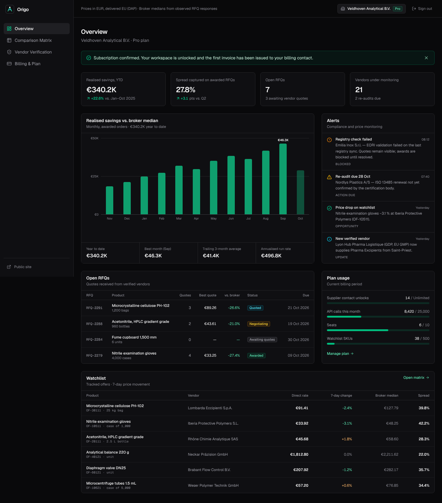

# Origo — Direct Sourcing Intelligence

B2B wholesale price comparison and vendor-verification platform for European procurement teams. Origo indexes audited manufacturers, laboratory suppliers, distributors and EU logistics hubs, normalises their quotes to delivered cost, and shows exactly what brokers add on top.

This repository contains the production frontend: the marketing site, the live comparison matrix with the Price Spread Analyzer, the subscription and access portal, and the member dashboard.

> **Demo data.** Every vendor, quote and figure in `lib/data/*` and `lib/site.ts` is fictional and exists to exercise the UI. Replace these with audited figures before publishing.

| Landing | Comparison matrix | Price Spread Analyzer |
| --- | --- | --- |
|  |  |  |

| ROI calculator | Access portal | Member dashboard |
| --- | --- | --- |
|  |  |  |

## Stack

| Concern | Choice |
| --- | --- |
| Framework | Next.js 16 (App Router, Turbopack, Cache Components + Partial Prefetching) |
| UI | React 19, Tailwind CSS v4, Lucide icons |
| Language | TypeScript (strict) |
| Fonts | Geist Sans / Geist Mono via `next/font` |
| Charts | Hand-built HTML/CSS charts, no chart library |

## Getting started

```bash
npm install
cp .env.example .env.local   # set SESSION_SECRET (≥ 32 chars)
npm run dev                  # http://localhost:3000
```

| Script | Purpose |
| --- | --- |
| `npm run dev` | Development server |
| `npm run build` / `npm start` | Production build and server |
| `npm run lint` | ESLint (Next.js core-web-vitals + TypeScript rules) |
| `npm run typecheck` | Generate route types, then `tsc --noEmit` |

## Routes

| Route | Rendering | Purpose |
| --- | --- | --- |
| `/` | Static | Landing page: hero with market snapshot, live ticker, problem, workflow, Price Spread Analyzer, verification, ROI calculator, pricing, FAQ |
| `/matrix` | Static | Public comparison matrix (preview mode: vendor identities masked) |
| `/access` | Partial prerender | Subscription & access portal: tier, company/VAT details, payment method, instant unlock |
| `/dashboard` | Partial prerender | Overview: KPIs, realised-savings chart, alerts, RFQs, plan usage, watchlist |
| `/dashboard/matrix` | Partial prerender | Member matrix with vendor identities, CSV export (Pro+), RFQ contact |
| `/dashboard/verification` | Static | Vendor register: registry checks, audit scores, re-audit schedule |
| `/dashboard/billing` | Partial prerender | Current plan, usage meters, plan change, invoices, VAT treatment |
| `POST /api/checkout` | Dynamic | Validates checkout, creates the subscription, sets the signed workspace cookie |
| `PATCH /api/subscription` | Dynamic | Changes tier or billing cycle |
| `DELETE /api/session` | Dynamic | Signs out of the workspace |
| `GET /api/v1/offers` | Dynamic | JSON offers API using the same query engine as the matrix |

Without a workspace cookie the dashboard renders a read-only **demo workspace** with Pro entitlements, so the product can be evaluated without checkout.

## Architecture

```
app/
  (marketing)/            Public site — shared header/footer layout
    page.tsx              Landing page
    matrix/page.tsx       Public comparison matrix (masked)
    access/page.tsx       Subscription & access portal
  dashboard/              Member app — static shell, session-dependent parts behind <Suspense>
  api/                    Route handlers (checkout, subscription, session, v1/offers)
  globals.css             Design tokens (@theme) and component CSS
components/
  ui/                     Primitives: Button, Badge, Panel, Field, Segmented, ToggleChip, Switch, RangeField, Sheet, status badges
  marketing/              Landing sections, ROI calculator, header/footer
  matrix/                 ComparisonMatrix (state), FilterPanel, MatrixTable (table ≥ md, cards < md), PriceSpreadAnalyzer
  charts/                 BuildUpChart (stacked price build-up), SavingsChart (monthly columns)
  pricing/                Tier cards shared by landing page and billing
  access/                 Checkout flow
  dashboard/              Sidebar, workspace badge, KPI tiles, usage meters, plan manager, vendor register
lib/
  types.ts                Domain model (Supplier, Product, Offer, MatrixRow, plans)
  data/                   Demo vendor registry, product benchmarks, quotes, dashboard data
  data/catalog.ts         Server data access — `"use cache"` + `cacheLife("minutes")` + `cacheTag("market-snapshot")`
  matrix/query.ts         Pure filter/sort/CSV engine shared by UI and API
  matrix/rows.ts          Joins offers → rows; masks vendor identity for non-members
  spread.ts               Channel price build-up and spread summary
  roi.ts                  Savings model and log-scale spend slider mapping
  plans.ts                Tiers, entitlements, pricing, B2B VAT treatment
  session.ts              HMAC-signed httpOnly workspace cookie
  billing/                Provider adapter, checkout validation, invoice ledger
```

### Rendering model

Cache Components is enabled. Public pages are fully static; market data comes from `getMarketSnapshot()`, which is cached for minutes and tagged so a feed ingest can call `revalidateTag("market-snapshot")`. Anything that reads the workspace cookie (`getWorkspace()`) is rendered inside its own `<Suspense>` boundary, so the dashboard shell prerenders and session-specific sections stream in.

Vendor masking happens on the server in `lib/matrix/rows.ts`; masked rows never contain legal names, cities or hub locations, so nothing identifying reaches the public client bundle.

### Pricing model

Each product carries four cumulative channel levels per pricing unit:

```
factory (EXW) → direct landed (DAP) → authorised distributor → broker median
```

- **Spread** (matrix) = broker median ÷ verified direct quote − 1.
- **Build-up** (analyzer) = factory rate, freight/packaging/duty, distributor margin, broker markup.
- **ROI**: avoidable share of broker spend = m ÷ (1 + m), applied to the addressable share, net of the annual membership fee.

### Tiers and entitlements

| | Preview (public) | Basic | Pro | Enterprise |
| --- | --- | --- | --- | --- |
| Vendor identities and contact | — | ✓ | ✓ | ✓ |
| Price Spread Analyzer | ✓ | ✓ | ✓ | ✓ |
| CSV export | — | — | ✓ | ✓ |
| Alerts and watchlists | — | — | ✓ | ✓ |
| REST API | — | — | 25k / month | 500k / month |
| SSO / SCIM | — | — | — | ✓ |
| Invoice billing | — | — | annual | ✓ |

Entitlements are defined once in `lib/plans.ts` and read by the matrix, the API, the billing page and the pricing cards.

## Payments and invoicing

`lib/billing/provider.ts` defines the `BillingProvider` interface. The bundled `SandboxBillingProvider` confirms subscriptions synchronously so the dashboard unlocks immediately; **it does not charge anything**.

To go live, implement the interface against your corporate-payments provider (for example Stripe Billing for cards and SEPA Direct Debit, GoCardless for SEPA mandates, or an ERP invoicing bridge for net-30 invoices) and export it as `billing`. Card and IBAN data must be captured by the provider's hosted fields: the access portal marks the mount point and never collects payment data itself (PCI DSS SAQ-A scope).

VAT handling (`computeTax`) assumes a German seller: 19 % for German customers, reverse charge for EU customers with a VAT ID, outside scope for CH/NO/UK. Checkout requires a VAT ID for EU customers outside Germany.

## API

```
GET /api/v1/offers?q=acetonitrile&category=Analytical%20Reagents&cert=ISO%209001&region=CEE,Benelux
                  &maxMoqValue=5000&maxLeadTime=10&auditedOnly=true&sort=unitPrice&dir=asc
```

Responses include product, vendor (masked unless the workspace plan includes API access), price, spread, MOQ, lead time and dispatch hub. Filtering and sorting use `lib/matrix/query.ts`, so results match the UI.

## Design system

- **Surfaces:** zinc scale (`canvas` #09090b → `surface-3` #1f1f23), hairline borders (`line`, `line-strong`).
- **Accents:** emerald for direct pricing and savings, cyan for live and informational signals.
- **Chart series** (fixed order, validated for colour-vision deficiency and ≥ 3:1 contrast on `surface-2`): factory `#0f9f6e`, logistics `#3b82f6`, distributor `#d97706`, broker `#a855f7`.
- **Status colours** (emerald / amber / orange) always appear with an icon and a text label.
- Charts include keyboard-focusable marks with tooltips, and a table or legend that shows every value without hovering.
- Dense tables use tabular figures, a sticky header, and compact or comfortable density.

## Before production

- Set `SESSION_SECRET`. Without it, production uses a per-process random key, so sessions end on every restart.
- Replace `SandboxBillingProvider`, and add a webhook route that updates the session or account store on payment events.
- Replace the cookie-only workspace with your identity provider (seats, SSO) and a persistent account store.
- Validate VAT IDs live against VIES at checkout.
- Add rate limiting to `/api/checkout` and `/api/v1/offers`.
- Replace demo data and marketing figures; add legal pages (imprint, privacy, terms, DPA).
